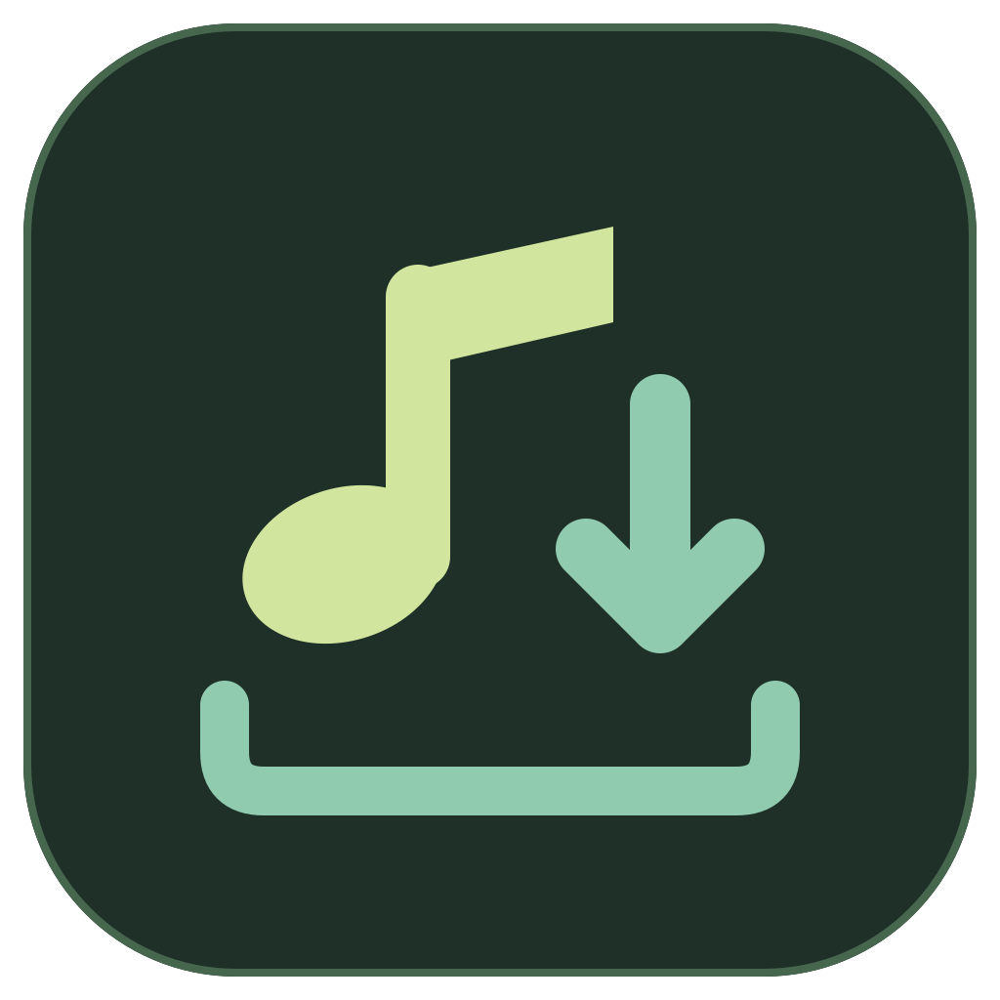
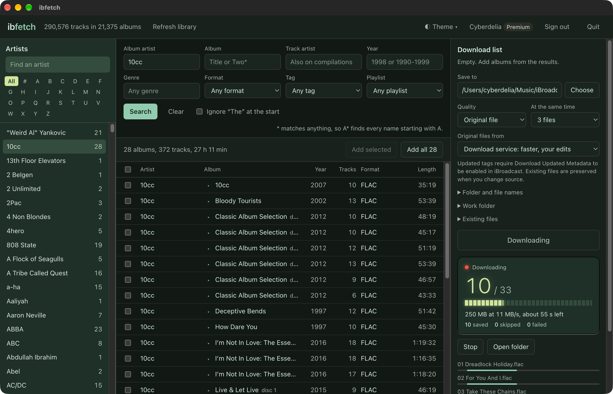
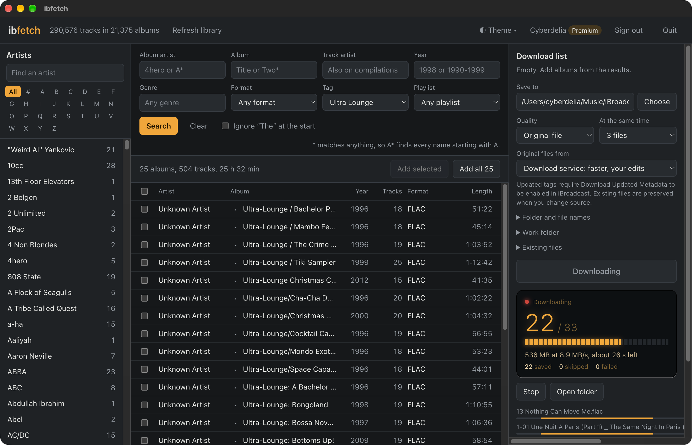

<p align="center"></p>
<h1 align="center">ibfetch</h1>
<p align="center"><b>Selective music downloader for iBroadcast.</b></p>
<p align="center"><picture><source media="(prefers-color-scheme: dark)" srcset="assets/ibroadcast-dark-compact-powered.svg"></picture><br><sub>Independent app by Cyberdelia</sub></p>
<p align="center"><a href="https://github.com/cyberdeliaAI/ibfetch/actions/workflows/tests.yml"></a> <a href="LICENSE"></a></p>

Selectively download music from your iBroadcast library using a standalone desktop
app, a local browser interface or the command line. All three share the same engine.

Download a chosen part of your iBroadcast library. All albums by one artist, every artist starting with A, one genre, a decade, a tag or a playlist. MediaSync Lite can only pull the whole library in one go. ibfetch picks exactly what you ask for.

- Standalone apps for macOS, Windows and Linux, plus Python/browser and terminal use.
- One Python file, no packages to install. Python 3.8 or newer on Linux, macOS or Windows.
- Original files by default (FLAC stays FLAC), with the tags you edited in iBroadcast, or MP3 at 96 to 320 kbps.
- Safe to stop and start again. Finished files are skipped; an interrupted track downloads again.
- Signs in through iBroadcast's own approval page. ibfetch never sees your password.

Original files and bitrates other than 128 need iBroadcast Premium. Free accounts can use MP3 128 kbps.

ibfetch is an independent app, not made or endorsed by iBroadcast. The official
Powered by iBroadcast logos are used unchanged under its [branding guidelines](https://help.ibroadcast.com/en/developer/branding).

## Updates

The app checks GitHub for a new stable release at startup and while open, at most
once a day. A newer version appears as **Update available** in the header. Click
it for the release page and downloads. The version button also offers a manual
check and an option to turn automatic checks off. No account or library data is sent.
Installation is manual; stop ibfetch before replacing the app or upgrading with Homebrew.

## File metadata

Original files come from **iBroadcast's download service** by default, the same service
behind the web player's Download Tracks and MediaSync Lite's Download Library. With your
account's **Download Updated Metadata** setting on, it writes the tags you edited in
iBroadcast into each file: title, artists, album, year and genre. In testing it was also
about three times faster than the streaming server (6.3 against 1.8 MB/s per track).

iBroadcast rebuilds each file to do this. FLAC stays lossless: the bytes differ from
your upload, but in testing the decoded audio was identical. Some tag details come from
iBroadcast's service, not from ibfetch:

- the date becomes a year (`1998-08-03` becomes `1998`);
- a separate `YEAR` tag from your upload is left as it was, even when you changed the year;
- an additional artist can appear twice in the artist tag.

Choose **Streaming: exactly as uploaded** in the app, or `--source stream`, for the file
byte for byte as you uploaded it. Streaming is slower but can resume a half-downloaded
track. MP3 bitrates always stream. See [iBroadcast's export guide](https://help.ibroadcast.com/exporting-library)
for its setting.

If the download service can't deliver a track, ibfetch asks again twice and then saves
the uploaded file by streaming. Such a track is listed with a note and has the tags as
uploaded. The note is kept in the hidden manifest, including after a failed move from
the work folder, a retry or verification. Names and folders always use your current iBroadcast library data. The hidden
JSON manifest records download identity and integrity; it never writes tags or artwork.

## Screenshots

**Forest palette:** browse albums by artist while downloading original-quality files.



**Amber · Original palette:** filter the library by tag and follow download progress.



## Install

### Download an app

Get the current downloads from [Releases](https://github.com/cyberdeliaAI/ibfetch/releases/latest).
The desktop apps include Python; you do not need Python, Node.js or npm installed.

| System | Download for 1.5.0 | Open after extracting |
| --- | --- | --- |
| macOS 13+, Apple Silicon (M1 or newer) | [macOS arm64 ZIP](https://github.com/cyberdeliaAI/ibfetch/releases/download/v1.5.0/ibfetch-1.5.0-macos-arm64.zip) | `ibfetch.app` |
| macOS 13+, Intel | [macOS x64 ZIP](https://github.com/cyberdeliaAI/ibfetch/releases/download/v1.5.0/ibfetch-1.5.0-macos-x64.zip) | `ibfetch.app` |
| Windows 10/11, x64 | [Windows x64 ZIP](https://github.com/cyberdeliaAI/ibfetch/releases/download/v1.5.0/ibfetch-1.5.0-windows-x64.zip) | `ibfetch.exe` |
| Linux desktop, x64 | [Linux x64 tar.gz](https://github.com/cyberdeliaAI/ibfetch/releases/download/v1.5.0/ibfetch-1.5.0-linux-x64.tar.gz) | `ibfetch/ibfetch` |
| Python/browser or CLI, any supported OS | [Python ZIP](https://github.com/cyberdeliaAI/ibfetch/releases/download/v1.5.0/ibfetch-1.5.0-python.zip) | See below |

Extract the **whole archive**, then keep all extracted files together. Linux desktop
builds are tested on Ubuntu 22.04; other distributions may need their normal
Chromium desktop libraries. Windows ARM and Linux ARM desktop builds are not supplied;
use Python/browser on those systems.

**macOS:** move `ibfetch.app` to Applications and open it. The app has an ad-hoc
signature and is not Apple-notarized. If the first launch is blocked, review the
source/download, then use **System Settings > Privacy & Security > Open Anyway**
for this app. Do not disable Gatekeeper globally. [Apple's instructions](https://support.apple.com/en-gb/102445).

**Windows:** right-click the ZIP, choose **Extract All**, then open `ibfetch.exe`
from the extracted folder. These builds are not Authenticode signed; Windows may
show an unrecognized-publisher warning. Review the source and SHA-256 before deciding
to run it; organizational policies may prevent unsigned apps.

**Linux:** extract the tar.gz in your file manager, or run:

```sh
tar -xzf ibfetch-1.5.0-linux-x64.tar.gz
./ibfetch/ibfetch
```

A graphical desktop is required for Electron. For a terminal-only machine, use the
Python CLI. Do not add `--no-sandbox` to work around system restrictions.

### Homebrew

For the Mac desktop app and its bundled `ibfetch-cli`:

```sh
brew install --cask cyberdeliaAI/apps/ibfetch
```

For the Python/browser and terminal version on macOS or Linux:

```sh
brew install --formula cyberdeliaAI/apps/ibfetch
ibfetch
```

The formula installs Python as a dependency. The cask and formula can coexist:
`ibfetch-cli` uses the app's bundled Python; `ibfetch` uses Homebrew Python.
Homebrew does not bypass macOS security checks. Quit ibfetch before upgrading:

```sh
brew update
brew upgrade --cask cyberdeliaAI/apps/ibfetch
# Or, for the formula:
brew upgrade --formula cyberdeliaAI/apps/ibfetch
```

Uninstall with the matching `brew uninstall --cask` or `brew uninstall --formula`
command. Music, settings and sign-in records are kept.

### Python/browser without Homebrew

Install a supported [Python 3](https://www.python.org/downloads/) if needed
(Python 3.8+ is compatible; prefer a currently maintained version). Extract the
Python ZIP above, open a terminal in that folder and run:

```sh
# macOS / Linux
python3 ibfetch.py
```

```powershell
# Windows
py -3 ibfetch.py
```

This opens the local browser app. Keep the terminal open while using it. There are
no pip packages to install. You can also clone the repository and run the same file.
For a fixed port or to open the printed link yourself:

```sh
python3 ibfetch.py gui --port 9000 --no-browser
```

The CLI examples below use the shorter `ibfetch` command, provided by the formula.
Without that installation, replace `ibfetch` with `python3 ibfetch.py` on macOS/Linux
or `py -3 ibfetch.py` on Windows. The Mac cask also provides `ibfetch-cli`.
Optionally install a command on macOS/Linux without moving your source file:

```sh
mkdir -p ~/.local/bin
install -m 755 ibfetch.py ~/.local/bin/ibfetch
# Ensure ~/.local/bin is on your PATH.
```

Each release includes SHA-256 companions for its download archives. For checksums,
first-launch details and building from source, see [desktop notes](docs/desktop.md).

## The app

```bash
ibfetch
```

Without a command, ibfetch opens its app in your browser. It runs on your own computer only: the page lives at `127.0.0.1` and only the link printed in your terminal opens it. Keep the terminal window open while you use it.

1. Sign in with iBroadcast. The page shows a code and a button to iBroadcast's approval page.
2. Pick an artist on the left, a letter for every artist on that letter, or search with the fields. `*` matches anything.
3. Tick albums and add them to the download list, or add all results at once. The arrow before an album shows its tracks. Shift-click selects a range.
4. Choose a folder, a quality and how many files at the same time, then press Download.
   For original files, **Original files from** chooses the download service or streaming.

The download list can mix several searches. Stop whenever you like: Try again carries on, finished files are skipped. Quit stops the app.

Close ibfetch 1.1.3 or older before downloading into the same folder with 1.1.4+;
their lock files live somewhere else. Lock files are kept in bounded slot sets in
ibfetch's own settings folder, never in your download folder. An `.ibfetch-locks` folder
left in a download folder by 1.1.0 to 1.1.3 is no longer used: you can delete it once no
older ibfetch is running. Different tracks sharing a lock slot wait their turn and
remain cancellable.

The app saves your folder, quality, source, file name and work folder settings when you start a download.
Use **Theme** in the header to choose Tagcast's Forest, Ocean, Warm or iBroadcast
inspired colours, independently of Auto, Light or Dark appearance. Forest is the
default. Theme choices are saved immediately and restored before the page is
painted, including when the desktop app starts on a new local port.
**Amber · Original** brings back ibfetch's original grey surfaces and orange
accents, in both light and dark appearance.
The pending download list is held in this browser tab and is lost if you reload it.
Use `ibfetch gui --port 9000` for another port, or `--no-browser` to only print the link.

The terminal additionally offers repeatable filter values, explicit album/track IDs
and dry-run output. In the GUI you can combine multiple searches in the download list.

## Saving to a NAS

ibfetch can save straight to a mounted network share. Two things work differently
from a local disk there, and ibfetch handles both:

- **Lock files stay on your computer**, in ibfetch's settings folder. Some SMB mounts silently grant conflicting locks, so locks on such a share
  would not protect concurrent writers. ibfetch checks that its own lock folder enforces locks and refuses to
  download if it doesn't.
- **Each file's SHA-256 is computed while it downloads.** A share that gives a renamed
  file its own timestamp no longer causes a second read of the whole file. The saved
  baseline uses the timestamp after the rename.

Optionally, set a **Work folder** in the app, or `--work-folder` in the terminal, to a
folder on your computer. Each track then downloads there first and moves to the share
as soon as it's complete and checked. Partial downloads never land on the share, and a
sleeping NAS or dropped Wi-Fi only delays the move. A track that couldn't be moved stays
in the work folder and moves on the next run without downloading it again. The work
folder must be outside the download folder and needs room for active downloads
and any completed tracks waiting for the share. Failed moves can accumulate locally.

`--verify` also checks completed files waiting in the work folder before moving
them. Cleanup preserves changed local leftovers and their records, with a note;
it never silently accepts them as a new baseline.

Two computers writing into the same share folder at the same time are not protected
from each other. Run one ibfetch per download folder.

## The command line

Everything below works without the app.

### Sign in

The desktop app opens the official iBroadcast sign-in page in a separate, isolated
window and returns to ibfetch after approval. The Python/browser version opens a
popup. If a popup is blocked or the provider requires your normal browser, choose
**Use your browser or a code instead**. Closing or cancelling the window stops only
that sign-in attempt; an already approved connection is preserved. iBroadcast's
remembered website sign-in stays in a separate desktop profile, so the first login
may still ask for your account details. Passwords stay on iBroadcast.

```bash
ibfetch login
```

The terminal command prints a link and a code. Open the link, approve ibfetch and you're done. The sign-in is saved and refreshed automatically.

ibfetch currently uses the same public OAuth client ID as Tagcast, so the approval
page can show Tagcast. Tagcast does not need to be installed. To use your own
iBroadcast client, run `ibfetch login --client-id YOUR_ID` or set
`IBROADCAST_CLIENT_ID` before starting the app. This is an independent community
tool, not an official iBroadcast application.

### Look before you download

```bash
ibfetch artists "A*"                 # album artists starting with A, with album counts
ibfetch list --artist "4hero"        # albums that would be downloaded
ibfetch list --artist "4hero" --tracks
```

The first run downloads your library index (the list of tracks, not the music). It's cached and only fetched again when your library changes.

### Download

```bash
# every album by one artist
ibfetch get --artist "4hero" -o ~/Music/iBroadcast

# every album artist starting with A, counting "The Avalanches" as A too
ibfetch get --artist "A*" --skip-the -o ~/Music/iBroadcast

# albums whose title starts with A
ibfetch get --album "A*"

# FLAC albums from the nineties
ibfetch get --year 1990-1999 --format flac

# a tag or a playlist
ibfetch get --tag "2 Meter Sessie"
ibfetch get --playlist "Road trip"

# an artist's tracks on compilations too
ibfetch get --track-artist "Björk"

# small MP3s for a phone
ibfetch get --artist "Azymuth" --quality 192 -o ~/phone-music
```

Add `-n` to see what would download without downloading. Selections over 1,000 tracks ask first. Add `--yes` to skip that question in scripts.

Stop any time with Ctrl+C. Run the same command again and it carries on where it stopped.

### Filters

Combine as many as you like: a track has to pass all of them. Repeat an option to match any of its values, like `--artist "A*" --artist "B*"`.

| Option | Matches |
| --- | --- |
| `-a`, `--artist` | album artist |
| `-r`, `--track-artist` | track artist, so it also finds tracks on compilations |
| `-A`, `--album` | album title |
| `-g`, `--genre` | genre, including extra genres |
| `-y`, `--year` | `1997`, `1990-1999` or `2010-` |
| `-f`, `--format` | `flac`, `mp3`, `m4a`... |
| `-t`, `--tag` | iBroadcast tag |
| `-p`, `--playlist` | playlist |
| `--album-id`, `--track-id` | IDs, as shown by `list` |
| `--skip-the` | lets `B*` match "The Beatles" |
| `--all` | no filter: the whole library |

Names ignore case and accents, so `bjork` finds Björk. Only `*` (anything) and `?` (one character) are wildcards. A name without a wildcard has to match exactly: `--artist "Pink Floyd"`, or `--artist "*floyd*"` for anything containing it.

### Folders and file names

The default layout is

```
{albumartist}/{album} ({year})/{disctrack} {title}
```

which gives `4hero/Two Pages (1998)/01 Loveless.flac`. Multi-disc albums get `1-01`, `2-01` and so on. An unknown year leaves out the brackets.

Change it with `--layout`. Fields: `{albumartist}`, `{album}`, `{year}`, `{disc}`, `{track}`, `{disctrack}`, `{title}`, `{artist}`, `{genre}`, `{format}`.

```bash
ibfetch get --artist "A*" --layout "{genre}/{albumartist} - {album}/{track} {title}"
```

Characters that aren't allowed in file names on Windows or macOS become `_`, so the same folder works everywhere.

MP3 conversions include their bitrate in the file name, such as
`01 Loveless [192kbps].mp3`. Original files keep their original extension without
a bitrate suffix. If tracks would share a path, track-ID suffixes are assigned
against the active library, so selecting a track alone or with others gives the
same name for that library snapshot.

## Existing files and safe resume

Each folder containing downloads has **one hidden `.ibfetch.json` file**, with a
record for each filename: account/track/quality identity, size, modification time
and SHA-256 baseline. Keep this file with the whole music folder when moving or
backing it up. Normal repeated runs compare size and modification
time without rereading the audio. **Verify existing files** in the GUI, or `--verify`,
performs full hashing. The record contains no OAuth tokens. A changed streaming
URL does not invalidate an already downloaded file.

Incomplete audio uses `.part`; its source-bound resume record is in the same
hidden manifest. Keep the manifest and partial audio to resume. Only streamed tracks
resume: the download service can't continue a track, so ibfetch starts it over. A
streamed `.part` is also replaced when the next run uses the download service.
The server's byte range is checked before appending; HTTP 416 alone is never
treated as proof of completion. The local digest detects later local changes;
it is not a checksum supplied by iBroadcast.

A finished track counts as downloaded whichever source saved it, so switching sources
never downloads it again. To replace older streamed files with iBroadcast's edited tags,
download to a new output folder first so you can compare and keep your old copies.
If you deliberately remove an old audio file, the next run downloads it again; keep
the hidden manifest. An interrupted replacement can recover from its completed receipt,
after checking the new file's identity, length and SHA-256 against that receipt.

Changed files are **skipped: locally modified**; files without a trustworthy record
are **skipped: unverified**. Neither is overwritten or reported as a failed download.
These notes appear under Existing files in the transfer details and in terminal
output. A changed file could be retagged or damaged; a skip does not verify it.

To migrate old complete downloads you trust, explicitly select **Adopt existing
files I trust** or pass `--adopt-existing`. This records the file at each selected
path as a local baseline without changing audio or verifying its actual track or
bitrate with iBroadcast. It never reassigns a file already recorded for a different
account, track or quality. Old 1.0.1 records can instead be checked once with
`--verify` to add fast-skip metadata. Unverified partial files cannot be adopted.

### Upgrading existing JSON records

Close every older ibfetch version before opening 1.2.0+. When a download uses a
folder, recognized old per-track JSON records in that folder are copied into its
hidden manifest. Only after an atomic save are identical old sidecars removed.
Audio is neither changed nor downloaded again for this conversion. Complete,
partial and crash-recovery records retain their existing checks and identities;
work folders migrate too. Unrecognized JSON and conflicting records are preserved.
A damaged/future manifest is reported rather than replaced. This migration happens
for folders used by the run, not as an automatic scan of your whole NAS.

Manifest updates have separate local OS locks, so parallel downloads cannot erase
each other's records. Files in one folder share one JSON document: very large flat
custom layouts cost more metadata I/O than the usual artist/album folders. Writers
on different computers or with different settings homes are not coordinated.

OS locks protect target paths and are released when a process exits or crashes.
Their lock files live under `locks` in ibfetch's settings folder, not beside your
music. Their presence does not mean a download is active: leave them in place.
Stop older ibfetch versions before upgrading; do not run older and newer writers
against the same output simultaneously. Old `.ibfetch.lock` files and `.ibfetch-locks`
folders in download folders are not used by 1.1.4 and later.

### Options for `get`

| Option | Default | |
| --- | --- | --- |
| `-o`, `--out` | `./iBroadcast` | download folder |
| `-q`, `--quality` | `orig` | `orig`, `320`, `256`, `192`, `128` or `96` |
| `--source` | `download` | for original files: `download` (iBroadcast's tags, faster) or `stream` (exactly as uploaded, resumable) |
| `-j`, `--jobs` | `3` | parallel downloads, 1 to 8 |
| `--layout` | see above | folders and file names |
| `-n`, `--dry-run` | | show the selection, download nothing |
| `--yes` | | no question for big selections |
| `--refresh` | | fetch the library index again first |
| `--verify` | off | fully hash completed files against their local baseline |
| `--adopt-existing` | off | explicitly trust existing matching-path complete files |
| `--work-folder` | off | download to this local folder first, then move each finished track to `--out` |

## Where ibfetch keeps its files

The sign-in (`tokens.json`, readable only by you), the app's settings, the cached library index and the download lock files (`locks`) live in

- Linux: `~/.config/ibfetch`
- macOS: `~/Library/Application Support/ibfetch`
- Windows: `%APPDATA%\ibfetch`

Use `--home` or `IBFETCH_HOME` to put them somewhere else. `ibfetch logout` removes
the sign-in and library cache; the app's folder/quality/name settings are retained.

## How it works

ibfetch signs in with iBroadcast's OAuth device flow and reads your library index from `library.ibroadcast.com`. Original files come from `download.ibroadcast.com`, one track per request: ibfetch unpacks the ZIP while it arrives and checks iBroadcast's end marker, the archive's sizes and its CRC-32 before a file is saved. MP3 bitrates, and originals with `--source stream`, come from iBroadcast's streaming server. Every track is its own download, so one failed file never costs you a whole batch.

MediaSync Lite uses the same download service for the whole library at once, in numbered ZIP segments. The service also takes a list of tracks; asking for one at a time keeps a failure to one track and lets several download side by side.

## Troubleshooting

- **"Not signed in"** or **"didn't accept the session"**: run `ibfetch login`.
- **HTTP 403 or 404 on some tracks**: your library changed since the index was cached. Run with `--refresh`.
- **Nothing matches**: check the spelling with `ibfetch artists "name*"`.
- **Some files failed**: check their details; temporary network failures can be retried.
- **Saved with a note: Fallback**: the download service couldn't deliver that track, so it was streamed with the tags as uploaded. Delete it and run again to try the download service once more.
- **Modified or unverified complete file**: it was preserved and skipped; see verification/adoption above.
- **Unverified partial**: preserve it and choose a fresh output folder; partial adoption is not supported.
- **Another download is actively using this path**: wait for the other writer; crashes release the lock automatically.
- **File locks are not enforced in …**: ibfetch's settings folder is on a share that ignores locks. Keep it on a local disk; check `--home` and `IBFETCH_HOME`.
- **Downloaded to the work folder, but moving it failed**: the track is safe in the work folder. Check that the share is mounted, then run again; it moves without downloading again.
- **The app page says to open the link from the terminal**: each run makes a new private link. Use the one ibfetch just printed.
- **Choose doesn't open a folder window on Linux**: install `zenity` or `kdialog`, or type the path.

## License

ibfetch is [MIT licensed](LICENSE). Desktop downloads include third-party license
notices in their resources folder; see [third-party notices](docs/THIRD_PARTY_NOTICES.md).
