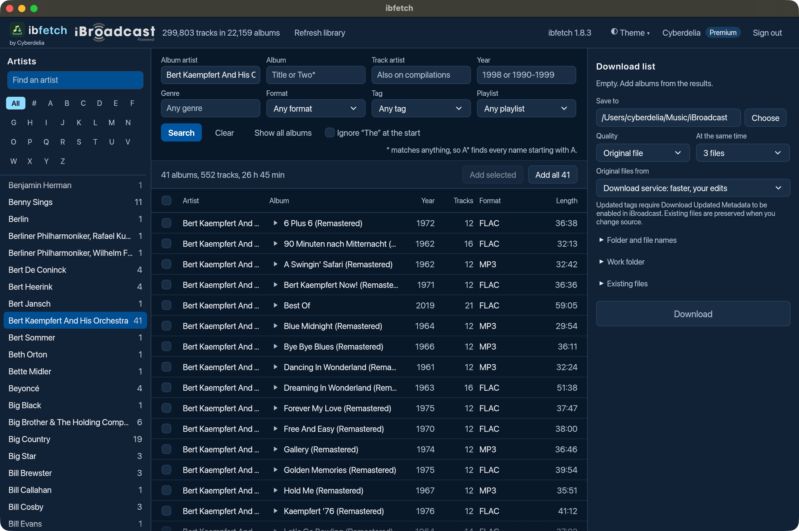
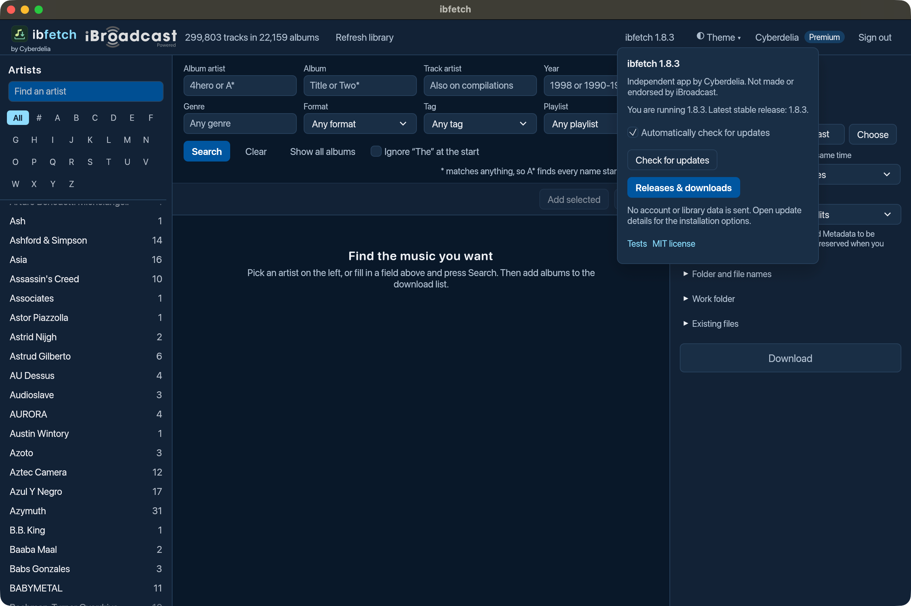

<p align="center"></p>
<h1 align="center">ibfetch</h1>
<p align="center"><b>Selective music downloader for iBroadcast.</b></p>
<p align="center"><picture><source media="(prefers-color-scheme: dark)" srcset="assets/ibroadcast-dark-compact-powered.svg"></picture><br><sub>Independent app by Cyberdelia</sub></p>
<p align="center"><a href="https://github.com/cyberdeliaAI/ibfetch/actions/workflows/tests.yml"></a> <a href="LICENSE"></a></p>

**[Download ibfetch 1.8.3](https://github.com/cyberdeliaAI/ibfetch/releases/tag/v1.8.3).**
One Rust executable provides a native desktop app, a local browser interface and
the command line.

| Platform | Download | After extracting |
| --- | --- | --- |
| macOS 13+, Apple Silicon | [Mac ARM64 ZIP](https://github.com/cyberdeliaAI/ibfetch/releases/download/v1.8.3/ibfetch-1.8.3-macos-arm64.zip) | Move `ibfetch.app` to Applications |
| macOS 13+, Intel | [Mac x64 ZIP](https://github.com/cyberdeliaAI/ibfetch/releases/download/v1.8.3/ibfetch-1.8.3-macos-x64.zip) | Move `ibfetch.app` to Applications |
| Windows x64 | [Windows ZIP](https://github.com/cyberdeliaAI/ibfetch/releases/download/v1.8.3/ibfetch-1.8.3-windows-x64.zip) | Open `ibfetch.exe` |
| Linux x64 | [Linux tar.gz](https://github.com/cyberdeliaAI/ibfetch/releases/download/v1.8.3/ibfetch-1.8.3-linux-x64.tar.gz) | Run `./ibfetch` |

Both Mac downloads are Developer ID signed and notarized by Apple. The Windows
executable is unsigned. For the browser app, run `ibfetch gui`. Use
`ibfetch --help` for terminal commands. The [classic 1.7.1 release](https://github.com/cyberdeliaAI/ibfetch/releases/tag/v1.7.1)
also provides the previous Python/browser version.

### Homebrew

Install the Mac desktop app with `brew install --cask cyberdeliaAI/apps/ibfetch`.
The cask also provides `ibfetch-cli`. For the browser and CLI on macOS or
Linux, use `brew install --formula cyberdeliaAI/apps/ibfetch`. To upgrade
an existing installation, quit the app, run `brew update` and use
`brew upgrade --cask cyberdeliaAI/apps/ibfetch` or
`brew upgrade --formula cyberdeliaAI/apps/ibfetch`.

## Features

- Browse and sort your music by album, artist, genre, year, format, tags or playlists.
- Download original files through iBroadcast's download service, or stream the
  uploaded file as-is. If the download service fails, ibfetch can fall back
  to streaming and records which tracks used the fallback. If iBroadcast reports
  a download bandwidth limit, ibfetch stops the queue. Start a new download
  manually once bandwidth is available again.
- iBroadcast's **Download Updated Metadata** setting controls whether the download
  service embeds edits made on iBroadcast. Original files and MP3 rates other
  than 128 kbps require iBroadcast Premium.
- Completed files are tracked with one hidden `.ibfetch.json` manifest per folder.
  Existing audio is preserved. An interrupted streaming download can resume when
  the saved range information still matches.

## Build and run 1.8.3

Use stable Rust 1.95 or newer. The default command opens the native desktop app.

```sh
cargo run --locked            # desktop
cargo run --locked -- gui     # local browser interface
cargo run --locked -- --help  # terminal commands
cargo run --locked -- get --artist "Björk" --dry-run
```

For a terminal or browser-only build, use `cargo build --locked --no-default-features`.
On macOS, `scripts/make-rust-macos-app.sh` builds `target/release/ibfetch.app`.
See the [usage guide](docs/usage.md) for settings and downloads and the
[macOS signing guide](docs/macos-signing.md) for signing development builds.

### Upgrading from 1.7.1 or 1.8.0

Quit the older app before using the same profile or download folder. ibfetch
keeps your settings and download manifests. Existing sessions can continue using
their original registration. To authorize ibfetch under its own name, sign out
and sign in again with 1.8.1 or later.

To try it separately, select a fresh profile and output
folder. Launch the desktop app with the following command, sign in, then choose
a new download folder.

```sh
cargo run --locked -- --home ~/ibfetch-test-profile
```

## Screenshots

**Browse albums by artist.** The ibfetch 1.8.3 desktop app on macOS shows 41 albums by Bert Kaempfert and His Orchestra, with track counts, formats and playing times.



**Check for updates.** Click the version number to compare your installed version with the latest release, turn automatic checks on or off, or open the downloads page.



## A Note on AI Usage

I use AI to help debug ibfetch, review code, explore technical options, and
occasionally write code. I review the suggestions I use, test the code, and
refine it before including it in the project.

I set the direction for ibfetch, design its architecture and interface, and make
the final technical decisions. I’m responsible for the quality and reliability
of every version I release.

## License

ibfetch is an independent app by Cyberdelia. Its source is under the
[MIT license](LICENSE). The Powered by iBroadcast logos are used under the
[iBroadcast branding guidelines](https://help.ibroadcast.com/en/developer/branding).
